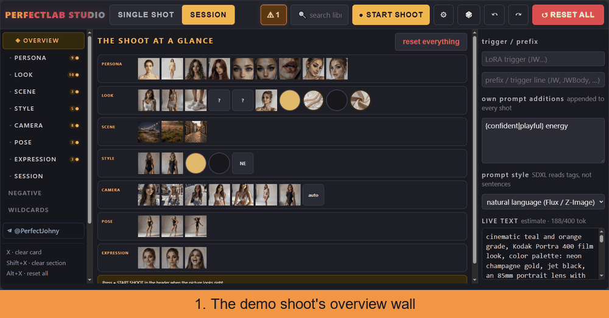

<p align="center"></p>

<p align="center"><sub>the blueprint draws itself. the status line below rewrites itself. everything else is static on purpose.</sub></p>

ten years in real estate, managing renovations by hand: eight apartments and seventy units under management, contractors, schedules, budgets, acceptance acts, a sales team built from zero. then I built the software that job always needed.

**BuildGuide** is a multi-role platform for construction projects. customers, foremen, specialists, designers, organizations: each role gets its own cabinet and their own slice of the truth. private while it is being built. what can be told:

```text
ACCEPTANCE SHEET
foundation      240 data models, one schema
frame           454 endpoints behind one typed adapter
utilities       7200+ tests in the CI gate on every push
finishing       5 locales, 15 000 keys each
site knowledge  338 work norms, СП and ГОСТ referenced
supervision     a 133-file internal map that audits itself with a script
```

the estimate engine is built from scratch, because the domain deserved better than a spreadsheet. the AI estimator reads a photo of a room and writes the estimate. payments settle through a ledger with idempotent webhooks, in the units accountants trust.

on the photography side: [PerfectLab Studio](https://github.com/perfectmodelslab/ComfyUI-PerfectLab), a ComfyUI node that builds a whole photoshoot from 625 photo-previewed picks, currently v1.1.18 on the ComfyUI Registry. a side project that behaves like a product.

<p align="center"><a href="https://github.com/perfectmodelslab/ComfyUI-PerfectLab"></a></p>

<p align="center"><samp>
$ buildguide --status<br>
<!-- status:begin -->
in development · latest public ship: perfectlab v1.1.19 · rewritten 2026-10-24
<!-- status:end -->
</samp></p>

igor vasilyev · [linkedin](https://www.linkedin.com/in/perfectlab-igor-vasilyev/) · [telegram](https://t.me/PerfectJohny) · [github](https://github.com/perfectmodelslab)
